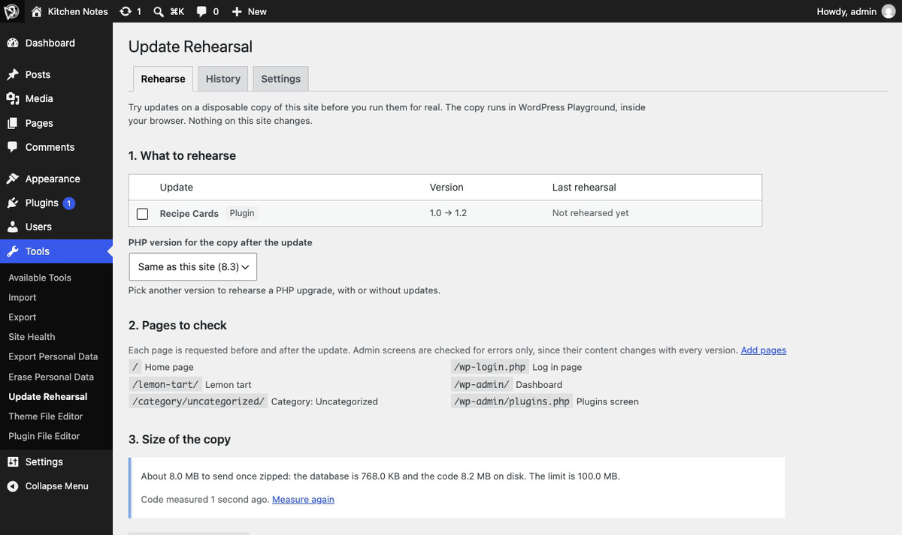
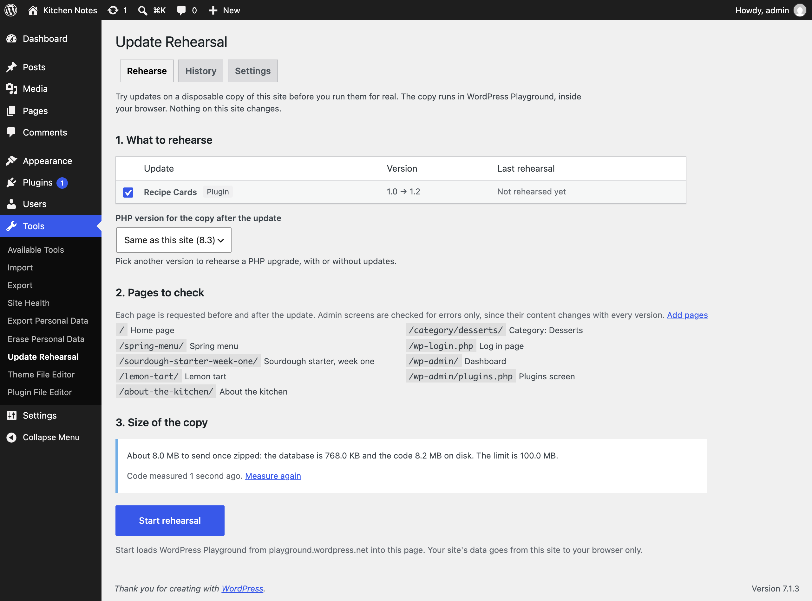
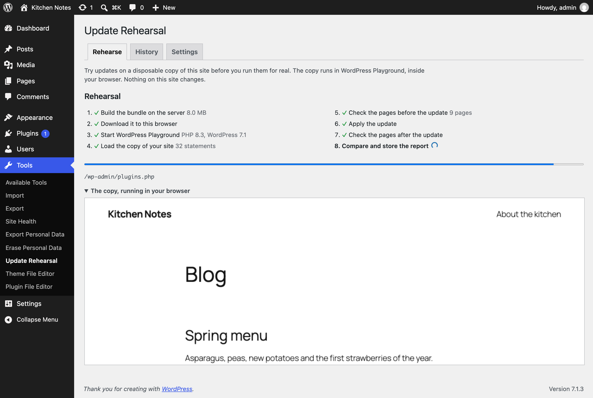
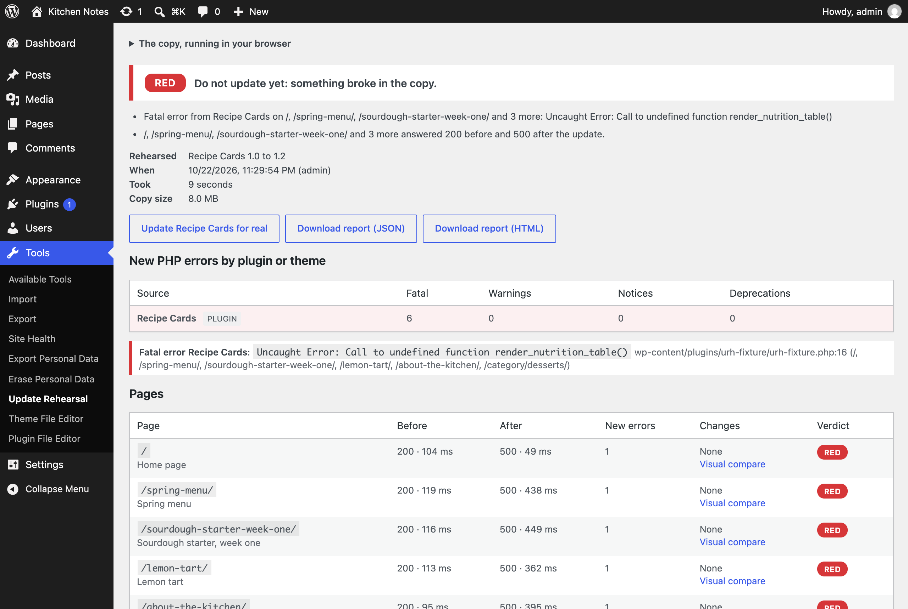
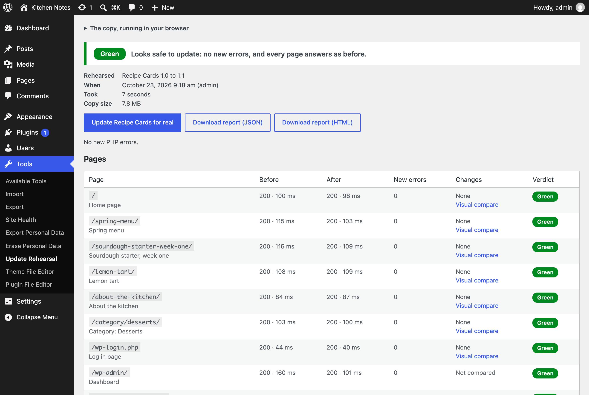
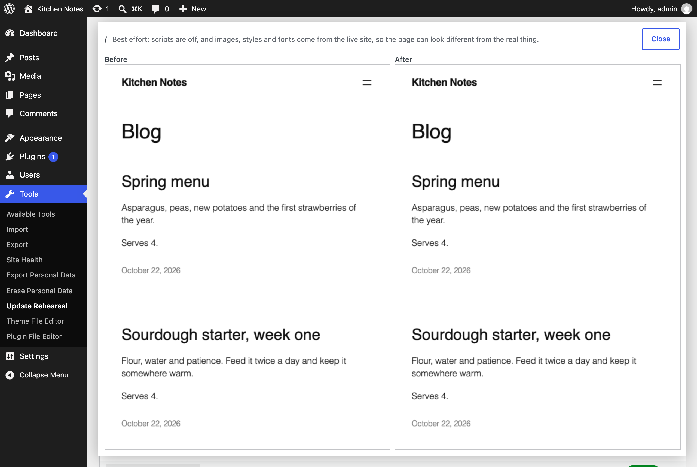
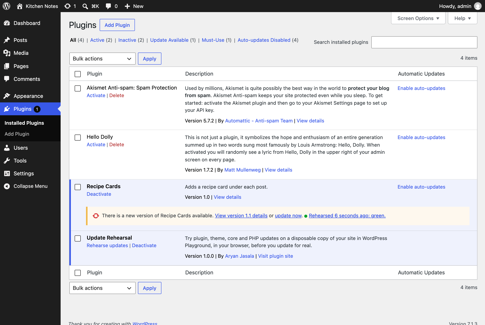

<p align="center"></p>

<h1 align="center">Update Rehearsal</h1>

<p align="center">
  <a href="https://playground.wordpress.net/?blueprint-url=https://raw.githubusercontent.com/aryanjasala/update-rehearsal/main/blueprint.json"></a>
  <a href="https://github.com/aryanjasala/update-rehearsal/releases/latest"></a>
  
  
  <a href="LICENSE.md"></a>
  <br>
  <a href="https://github.com/aryanjasala/update-rehearsal/actions/workflows/phpcs.yml"></a>
  <a href="https://github.com/aryanjasala/update-rehearsal/actions/workflows/phpstan.yml"></a>
  <a href="https://github.com/aryanjasala/update-rehearsal/actions/workflows/unit-tests.yml"></a>
  <a href="https://github.com/aryanjasala/update-rehearsal/actions/workflows/e2e-tests.yml"></a>
  <a href="https://github.com/aryanjasala/update-rehearsal/actions/workflows/plugin-check.yml"></a>
</p>

<p align="center">Try updates on a disposable copy of your site, in your browser, before you run them for real. It tells you what broke and which plugin broke it.</p>

<p align="center">
  
</p>

---

Updating a plugin, a theme, WordPress or the PHP version on a live site is a gamble. Visual regression services need a public site and an account, and they test after the fact. PHP compatibility checkers read your code, so they miss what only breaks when it runs. Update Rehearsal copies your site into WordPress Playground, inside your browser, requests your pages, applies the update there and requests them again. You get a verdict, the new PHP errors grouped by plugin, and what changed on each page. Nothing on the live site changes.

> [!NOTE]
> Free and open source under the GPL. No pro version, no upsells, no ads in wp-admin, no tracking. And it stays that way.

## Features

- **Plugin, theme and WordPress updates**, from the same update data the updater uses, so premium plugins that hook into it work too
- **PHP upgrades**: a second copy runs your pages on PHP 7.4 to 8.5 and reports what the new version broke or deprecated
- **A verdict**: green (nothing new), amber (warnings, deprecations, visible changes) or red (fatal error, 500, blank page)
- **New PHP errors by plugin or theme**, read from the copy's debug.log; an error inside WordPress goes to the plugin that called it
- **Each page before and after**: status, response time, new errors, a diff of the visible text and elements, and a side by side visual compare
- **A safe copy**: no transients or sessions, emails and password hashes replaced, no uploads, and the copy sends no email, runs no cron and makes no outgoing requests
- **Size first**: the screen shows how big the copy is once zipped, and refuses a site over the 100 MB limit, naming the plugin folders or tables that make it big
- **Update for real** links that ask first under amber or red and name the problems, JSON and HTML report downloads, "Rehearsed 2 hours ago: green" on the Plugins screen, and a history
- WP-CLI, a bundle for @wp-playground/cli in CI, abilities for AI agents, and a hook for every default

## Install

1. Download `update-rehearsal.zip` from the [latest release](https://github.com/aryanjasala/update-rehearsal/releases/latest).
2. In WordPress, go to **Plugins > Add New Plugin > Upload Plugin**, choose the zip and activate it.

Or with WP-CLI:

```sh
wp plugin install https://github.com/aryanjasala/update-rehearsal/releases/latest/download/update-rehearsal.zip --activate
```

Needs WordPress 6.6+ and PHP 7.4+. To try it first, the **Try in WordPress Playground** badge opens a throwaway WordPress in your browser with the plugin and some demo content.

## Quick look

Tick an update on **Tools > Update Rehearsal** and press **Start rehearsal**. From the command line:

```sh
wp update-rehearsal estimate
wp update-rehearsal updates
wp update-rehearsal list --verdict=red
wp update-rehearsal show 42

# The same copy in @wp-playground/cli, for CI
wp update-rehearsal bundle --output=bundle.zip
unzip -q bundle.zip -d bundle
npx @wp-playground/cli@latest server --mount=./bundle:/urh --blueprint=./bundle/blueprint.json
```

## Screenshots

<table>
  <tr>
    <td width="50%" valign="top"> Update Rehearsal: pick the updates or a PHP version. The pages to check and the size of the copy are below"><br><sub>Tools > Update Rehearsal: pick the updates or a PHP version. The pages to check and the size of the copy are below</sub></td>
    <td width="50%" valign="top"><br><sub>A rehearsal running: the copy of the site in WordPress Playground, inside the screen</sub></td>
  </tr>
  <tr>
    <td width="50%" valign="top"><br><sub>A red verdict: the update broke the front end, and the report names the plugin</sub></td>
    <td width="50%" valign="top"><br><sub>A green verdict with each page before and after</sub></td>
  </tr>
  <tr>
    <td width="50%" valign="top"><br><sub>The visual compare, side by side</sub></td>
    <td width="50%" valign="top"><br><sub>The Plugins screen: the latest rehearsal under the update notice</sub></td>
  </tr>
</table>

## Documentation

| Doc | What it covers |
| --- | --- |
| [Reference](docs/REFERENCE.md) | How a rehearsal runs, verdicts, hooks, abilities, WP-CLI, CI, the bundle format, data and privacy |
| [Development](docs/DEVELOPMENT.md) | Local setup, commands and tests |
| [Contributing](docs/CONTRIBUTING.md) | Pull requests, required checks and PR titles |
| [Releasing](docs/RELEASING.md) | How merged pull requests become releases |
| [Security](docs/SECURITY.md) | Reporting a vulnerability |
| [readme.txt](readme.txt) | What WordPress.org shows, with the FAQ and changelog |

## Project structure

```
update-rehearsal.php       plugin header and PSR-4 autoloader
src/
├── Plugin.php            creates the services
├── Settings.php          saved settings and their filters
├── Limits.php            filtered defaults: size cap, PHP versions, Playground address
├── Updates.php           pending updates and their packages
├── TestUrls.php          the pages to check
├── Bundle/               database export, code, size estimate, step-by-step builder, Playground scripts
├── Rehearsals.php        stored reports
├── Report.php            cleaning a report from the browser, the verdict filter
├── Rest/Controller.php   bundles and reports over REST
├── Admin/                Tools > Update Rehearsal, the Plugins screen note
├── Abilities.php         list-rehearsals, get-rehearsal, get-bundle-estimate
├── Cleanup.php           hourly clean-up
├── Privacy.php           export, erase, policy text
├── Health/SiteHealth.php Site Health test
└── Cli/Command.php       wp update-rehearsal
assets/
├── js/rehearsal-core.js  normalising, error parsing, diffs, verdicts (no dependencies)
├── js/admin.js           runs the rehearsal in Playground and shows the report
└── vendor/               @wp-playground/client, unchanged
tests/
├── Unit/                 PHPUnit
├── js/                   Node unit tests
└── e2e/                  Playwright specs, the fixture plugin and the Docker site
.wordpress-org/           screenshots
docs/                     reference, development, contributing, releasing
```

## More free plugins

Small plugins that each fill one gap in WordPress, all free with no pro version:

| | Plugin | What it does |
| --- | --- | --- |
|  | [Page Template Usage](https://github.com/aryanjasala/page-template-usage) | See which template every page uses, and fix the pages on a missing template |
|  | [Staging Guard](https://github.com/aryanjasala/staging-guard) | Stops staging copies from emailing real people or getting indexed |
|  | [Category & Tag Trash](https://github.com/aryanjasala/category-tag-trash) | A trash for categories, tags and custom terms, with undo and full restore |
|  | [Axle Read-Only Mode](https://github.com/aryanjasala/axle-read-only-mode) | Read-only mode for WordPress during migrations and deploys |
|  | [Restore Blocks from Revisions](https://github.com/aryanjasala/restore-blocks-from-revisions) | Restore a single block from an old revision, not the whole post |
|  | [Activity Log with Undo](https://github.com/aryanjasala/activity-log-with-undo) | An activity log where every change you can reverse has an Undo button |
|  | [Agent Governance](https://github.com/aryanjasala/agent-governance) | Hold risky AI agent calls for approval, preview what they change, and roll back a session |
|  | [Block Doctor](https://github.com/aryanjasala/block-doctor) | Scan the whole site for invalid and broken blocks and fix them in bulk, with undo |
|  | [Block Theme Ops](https://github.com/aryanjasala/block-theme-ops) | Find Site Editor changes that override your theme files, see the diff, reset them or send them to Git |
|  | [Role Right-Sizer](https://github.com/aryanjasala/role-right-sizer) | Recommends the smallest role each user needs, from what they actually do |
|  | [User Session Manager](https://github.com/aryanjasala/user-session-manager) | See every device signed in, sign out one, and limit sessions per role |

## License

Copyright Aryan Jasala. Licensed under [GPL-2.0-or-later](LICENSE.md).
